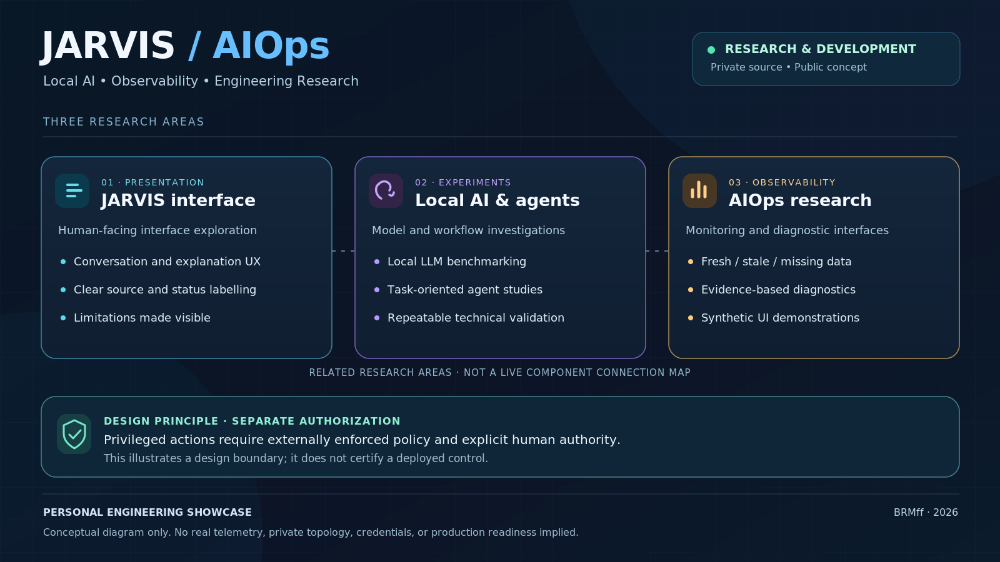

# JARVIS / AIOps — Engineering Showcase

**Local AI · Linux · Observability · Automation · Security-aware Engineering**

**Project status:** Research and active development  
**Original source code:** Private  
**This repository:** Public documentation and conceptual, synthetic visuals only

> **Conceptual illustration.** This is not a live architecture diagram, deployment inventory, monitoring screenshot, or certification of production readiness. No real telemetry is represented.

## Overview

JARVIS / AIOps is a personal engineering project exploring how local artificial intelligence, agent-oriented interfaces and observability can be combined in a privacy-conscious, Linux-based environment.

The project is developed incrementally through experimentation, documented decisions, reproducible testing and technical review. Components are at **different stages of development and validation**; progress in one area does not establish readiness of the whole ecosystem.

## Areas of work

### JARVIS — Human-facing interfaces

Research and development of conversational interfaces, clear status presentation and explanations that make technical limitations visible.

### Local AI and agents

Experiments with local language models, task-oriented agent designs and repeatable model evaluation. The project explores separation between model-generated suggestions and independently controlled permissions.

### AIOps — Observability and diagnostics

Research and development of system-monitoring interfaces, evidence-based diagnostics and explicit differentiation between fresh, stale, missing or unavailable data.

## Engineering approach

- **Local-first experimentation:** prefer inspectable, self-hosted technologies when practical.
- **Modular design:** describe and evaluate components separately rather than claiming a single certified system.
- **Permission boundaries:** privileged actions require authorization outside the AI model. This is an architectural principle, not a claim that every control is already deployed.
- **Evidence over screenshots:** document the circumstances and limits of tests before presenting results.
- **Privacy by design:** avoid disclosing infrastructure identifiers, credentials and sensitive implementation details.

For more context, see [engineering approach](docs/engineering-approach.md) and [validation and evidence](docs/validation.md).

## Technology areas

Linux · KDE neon · Docker · Python · Bash · PostgreSQL · Ollama · Git

These technologies describe relevant engineering experience and experiments, not a published deployment bill of materials.

## What's public here?

| Material | Scope |
| --- | --- |
| Conceptual diagram | Synthetic, independently created illustration of three research areas |
| Engineering notes | Public high-level approach, without internal architecture or source |
| Validation notes | How evidence will be described, without unverifiable performance claims |

[Read the disclosure policy](docs/disclosure-policy.md) for what is intentionally excluded.

## What this repository does **not** demonstrate

This repository does not establish that a complete agent system is running in production, that privileged actions are enabled, or that a particular security property has been certified in a live deployment. Public examples will be marked as synthetic or as independently verified evidence, as appropriate.

## About

Personal engineering work by **ffolgado**. See the [BRMff GitHub profile](https://github.com/BRMff) for professional background and other projects as they become public.

*Building useful technology through practical experiments, testing and continuous improvement.*

## Reuse and rights

No open-source licence has been selected for this documentation and artwork. Public visibility does **not** grant permission to reuse the private JARVIS/AIOps code or other project materials. Licensing can be reviewed separately before publishing reusable software.
